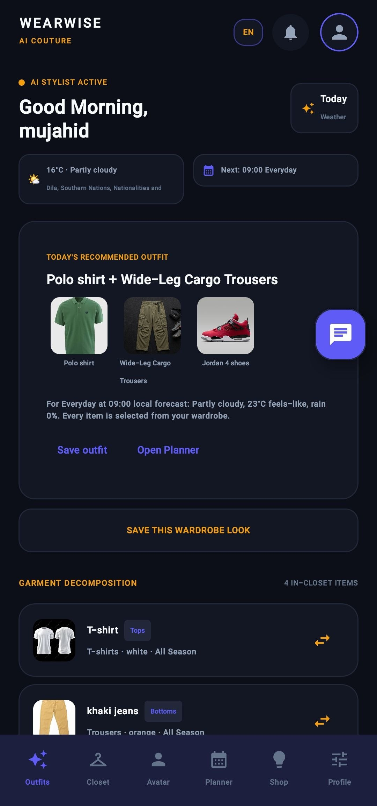
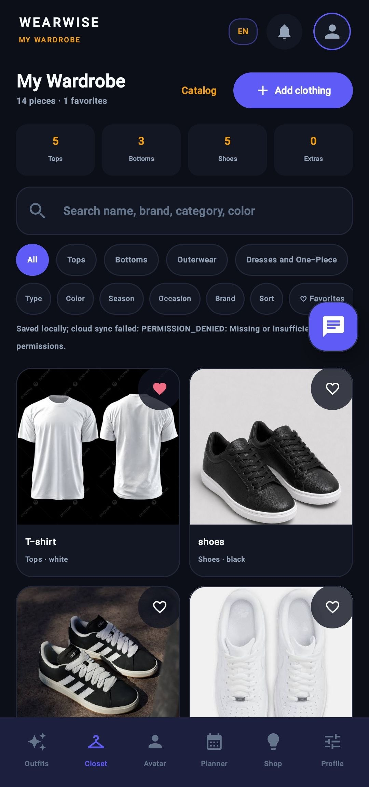
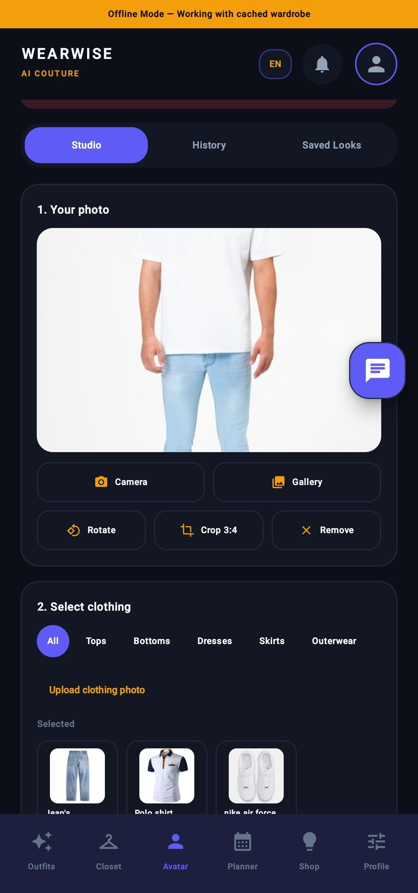
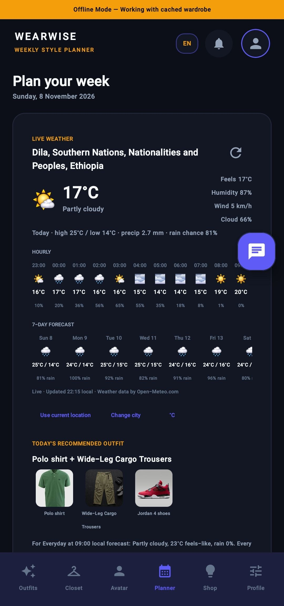
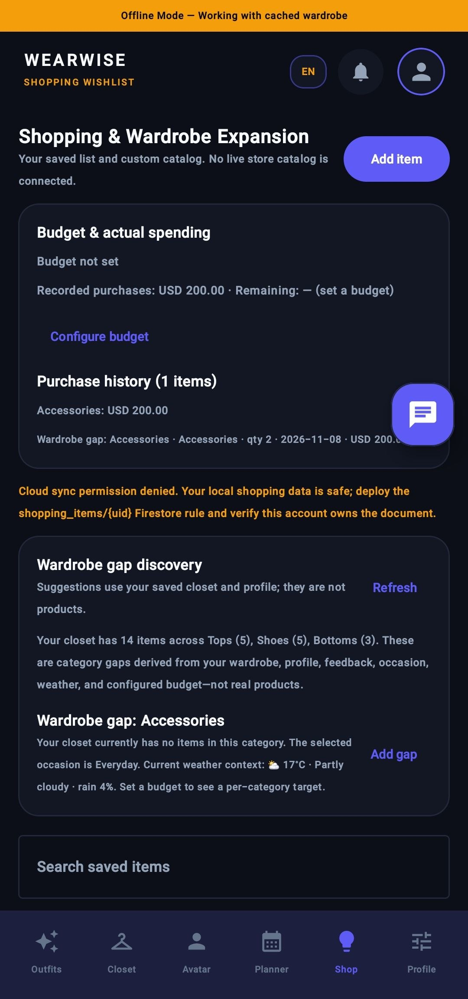
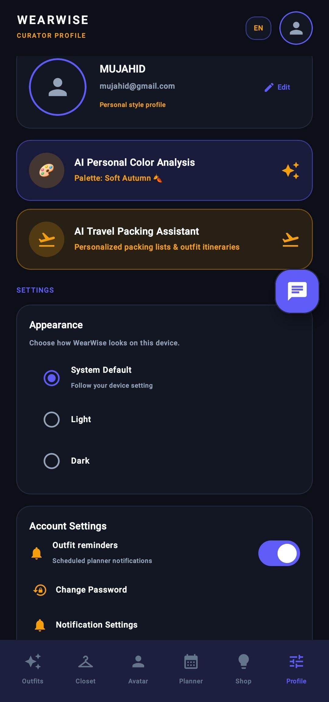

<div align="center">

# 👕 WearWise – AI-Powered Fashion & Virtual Try-On Application

### Your Personal AI Fashion Stylist

Discover your style, organize your wardrobe, and get smarter outfit recommendations.

<br/>

<a href="https://developer.android.com/">
  
</a>
<a href="https://kotlinlang.org/">
  
</a>
<a href="https://developer.android.com/jetpack/compose">
  
</a>
<a href="https://developer.android.com/topic/architecture">
  
</a>
<a href="https://firebase.google.com/">
  
</a>

</div>

---

---

## 📖 About WearWise

**WearWise** is an AI-powered Android fashion application designed to help users manage their wardrobes, discover outfit combinations, and make smarter fashion decisions.

The application combines artificial intelligence, personalized outfit recommendations, weather information, wardrobe management, shopping, and virtual try-on technology to provide a convenient and personalized fashion experience.

WearWise aims to make everyday fashion decisions easier through intelligent technology.

---


## 📱 WearWise Application Preview

<table>
  <tr>
    <td align="center">
      <strong>Home</strong><br>
      
    </td>
    <td align="center">
      <strong>Closet</strong><br>
      
    </td>
    <td align="center">
      <strong>Virtual Try-On</strong><br>
      
    </td>
  </tr>
  <tr>
    <td align="center">
      <strong>Planner</strong><br>
      
    </td>
    <td align="center">
      <strong>Shopping</strong><br>
      
    </td>
    <td align="center">
      <strong>Profile</strong><br>
      
    </td>
  </tr>
</table>


## ✨ Features

### 👔 1. Smart Wardrobe Management

- Add clothing using the camera or gallery.
- Organize clothes into categories.
- Store clothing images and details.
- Edit and delete wardrobe items.
- Search and filter clothing collections.

### 🤖 2. AI Outfit Recommendations

- Generate personalized outfit suggestions.
- Recommend combinations using actual wardrobe items.
- Consider clothing colors, styles, and preferences.
- Display outfit match scores.
- Explain why an outfit is recommended.

### 🧠 3. AI Outfit Feedback and Learning

- Like or dislike recommended outfits.
- Rate outfit combinations.
- Learn from previous user choices.
- Identify preferred colors and styles.
- Improve future recommendations using feedback.

### 👗 4. AI Virtual Try-On

- Select a personal photo.
- Choose garments from the wardrobe.
- Generate virtual try-on images using a compatible AI service.
- Preview generated outfit results.
- Save generated images.

**AI Model:** CatVTON can be used as an open-source virtual try-on model through a separate Python service.

### 🌤️ 5. Weather-Based Outfit Recommendations

- Retrieve real-time weather information.
- Display current temperature and weather conditions.
- Consider humidity, rain probability, and wind speed.
- Retrieve hourly and daily forecasts.
- Recommend outfits based on actual weather conditions.

**Weather API:** Open-Meteo.

### 📅 6. Smart Outfit Planner

- Organize outfits by date.
- Schedule outfits for upcoming activities.
- Manage planned events.
- View weather information.
- Connect outfit recommendations with scheduled activities.

### 🛍️ 7. Smart Shopping

- Browse clothing products and categories.
- Search and filter products.
- Save favorite products.
- Manage shopping lists.
- Track shopping budgets.
- Record purchases and expenses.
- Explore personalized shopping recommendations.

### 👤 8. Personal Profile

- Manage personal account information.
- Update profile details.
- Configure fashion preferences.
- Manage application settings.
- Customize supported appearance and language options.

### 📶 9. Offline-First Functionality

- Access locally saved wardrobe information.
- View previously saved outfits.
- Access stored planner information.
- View saved virtual try-on results.
- Store supported changes locally.
- Synchronize supported data when internet connectivity returns.

### 🔥 10. Firebase Integration

- User authentication.
- Cloud data synchronization.
- Connected user data management.
- Integration with local database architecture.

---

## 🛠️ Technologies Used

| Technology | Purpose |
|---|---|
| Kotlin | Android programming language |
| Jetpack Compose | Modern Android UI |
| MVVM | Application architecture |
| Repository Pattern | Data management |
| Room Database | Local data persistence |
| Firebase Authentication | User authentication |
| Firebase | Cloud integration |
| Kotlin Coroutines | Asynchronous operations |
| Kotlin Flow | Reactive data handling |
| Gemini API | AI-powered image understanding and fashion assistance |
| Open-Meteo API | Weather information |
| CatVTON | Open-source virtual try-on model |
| Git & GitHub | Version control |

---

## 🏗️ Application Architecture

WearWise follows an MVVM-based architecture with a repository layer to separate the user interface, business logic, and data operations.

```text
WearWise/
│
├── Presentation Layer
│   ├── Screens
│   ├── Components
│   ├── Navigation
│   └── ViewModels
│
├── Business Logic
│   ├── Outfit Recommendations
│   ├── AI Feedback and Learning
│   ├── Weather-Based Matching
│   └── Shopping Logic
│
├── Data Layer
│   ├── Repositories
│   ├── Local Data Sources
│   ├── Remote Data Sources
│   └── Models
│
├── Local Storage
│   └── Room Database
│
├── Cloud Services
│   ├── Firebase Authentication
│   └── Firebase Synchronization
│
└── External Services
    ├── Gemini API
    ├── Open-Meteo API
    └── Python Virtual Try-On Service
        └── CatVTON
```

---

## 🚀 Getting Started

### Prerequisites

Make sure you have installed:

- Android Studio
- JDK compatible with the project Gradle configuration
- Android SDK
- Git
- A Firebase project for cloud functionality

### 1. Clone the Repository

```bash
git clone https://github.com/mujahid5517/WearWise.git
```

### 2. Open the Project

1. Open Android Studio.
2. Select **Open**.
3. Choose the cloned `WearWise` directory.
4. Wait for Gradle synchronization.

### 3. Configure Firebase

1. Open [Firebase Console](https://console.firebase.google.com/).
2. Create or select your Firebase project.
3. Register your Android application using its exact application ID.
4. Download `google-services.json`.
5. Place the file inside the `app/` directory.

Expected location:

```text
WearWise/
├── app/
│   ├── google-services.json
│   ├── build.gradle.kts
│   └── src/
├── build.gradle.kts
└── settings.gradle.kts
```

Enable the Firebase services required by the application.

### 4. Configure External APIs

**Gemini API**

- Visit [Google AI Studio](https://aistudio.google.com/).
- Create an API key.
- Configure it using the application's supported secure configuration.
- Verify that the selected model supports the required operation.

**Open-Meteo API**

- Visit [Open-Meteo Documentation](https://open-meteo.com/en/docs/).
- Configure weather requests using the user's location.
- No API key is required for its free non-commercial API.

**CatVTON Virtual Try-On**

- Visit the [CatVTON GitHub Repository](https://github.com/Zheng-Chong/CatVTON).
- Set up the Python inference service separately.
- Connect Android through the appropriate backend API.

### 5. Run the Application

1. Connect an Android device or start an emulator.
2. Allow Gradle synchronization to finish.
3. Select the application configuration.
4. Click **Run**.

---

## 🔐 Security and Privacy

WearWise handles personal information and user-uploaded images.

Security considerations include:

- Secure authentication.
- Protected API credentials.
- Appropriate access controls.
- Secure backend communication.
- Proper handling of uploaded images.
- Validation of user input.
- Responsible handling of personal photos and generated images.

**Never hardcode private API keys into publicly distributed Android source code.**

---

## 🔮 Future Improvements

- Advanced AI fashion personalization.
- Multi-garment virtual try-on.
- Improved clothing recognition.
- Wardrobe analytics.
- Smart travel packing recommendations.
- Clothing usage and cost tracking.
- Improved offline synchronization.
- Additional fashion shopping integrations.

---

## ⚠️ Third-Party Services and Licensing

WearWise uses or may integrate with third-party services and open-source projects.

- **Gemini API:** Subject to Google's API terms, quotas, and pricing.
- **Open-Meteo:** Subject to its applicable terms and attribution requirements.
- **CatVTON:** Distributed under CC BY-NC-SA 4.0. Review the code and model-weight licenses before commercial use or redistribution.


## 🤝 Contributing

Contributions, suggestions, and bug reports are welcome.

To contribute:

1. Fork the repository.
2. Create a feature branch.
3. Make your changes.
4. Test your implementation.
5. Submit a pull request.

```bash
git checkout -b feature/your-feature-name
git add .
git commit -m "Add your feature description"
git push origin feature/your-feature-name
```

---

## 📄 License

A project license has not yet been specified.

Add a `LICENSE` file before distributing WearWise under an open-source license.

---

<p align="center">
  <strong>WearWise – Dress Smarter. Look Better. Feel Confident.</strong>
</p>

<p align="center">
  Built with ❤️ using Kotlin and modern Android technologies.
</p>
